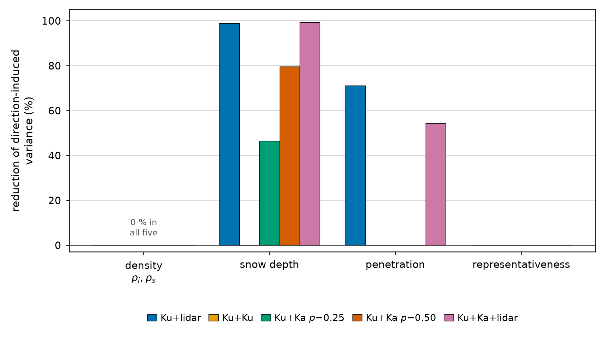

# Dual-frequency identifiability of sea-ice density

  

A second radar band is proposed to add density information to sea-ice thickness
retrieval. Whether it adds *identifiability* is a system property, and it can be
settled before launch. Every channel is converted through the same buoyancy factor,
so the density direction is common-mode and the density term enters the posterior
variance as

    σ² = 1/(1ᵀ C₋ρ⁻¹ 1) + a

with `a` split exactly between an ice-density part (93.7 / 96.7 %) and a
snow-density part (6.3 / 3.3 %). A differential scattering-surface sensitivity moves
`a` only through a signed, linkage-specific response whose ceiling is that share.

*The response to a differential sensitivity. Positive η (a band that sees the ice less
than Ku does) reduces the density term; the ceiling is the linkage share.*

## What it settles

| quantity | value |
|---|---|
| identity residual, 28 cells | 2.2 × 10⁻¹⁶ m² |
| ice-linked share of `a` | 93.7 / 96.7 % |
| snow-linked share of `a` | 6.3 / 3.3 % |
| 10 % edge, low / high state | 0.119 / 0.299 mm per kg m⁻³ |
| ceiling, η_opt | 2.194 / 5.806 mm per kg m⁻³ |
| assertions / tests | 42 / 12 |

## Contents

    code/info_geometry.py   states, channels, noise, information, Woodbury, response
    code/p5_numbers.py      every table and number, with 42 assertions
    code/check_package.py   the gate: assertions, text match, citations, worked example
    code/tests/             12 unit tests of the claimed properties
    out/                    every table as CSV, including p5_thresholds.csv
    figures/

## Quick start

    pip install numpy scipy pandas matplotlib
    python code/p5_numbers.py --check     # 42 assertions, non-zero on failure
    python code/tests/test_p5_numbers.py  # 12 tests
    python code/check_package.py          # the gate, plus a worked assessment

`check_package.py --eta 0.300` applies the paper's protocol to a supplied
differential and prints the tier it lands in.

## The paper

*Can a second radar band identify sea-ice density?* — submitted to **Advances in
Space Research**.

## Licence and citation

MIT (`LICENSE`), derived tables CC BY 4.0 (`DATA_LICENSE`). Cite the article and this
repository — see `CITATION.cff`.

---
[中文说明](README.zh-CN.md)
