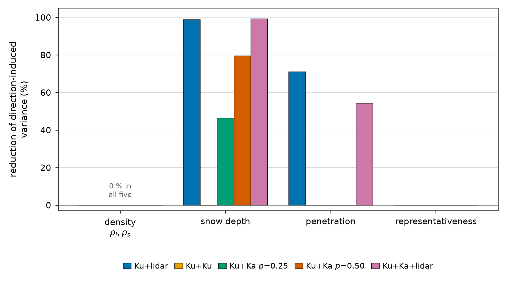

# 双频段能否识别海冰密度

  

用第二个雷达频段为海冰厚度反演增加密度信息，是常见的任务设想。它是否带来**可识别性**是一个
系统性质，可以在发射前就定论。所有通道都经同一个浮力因子转换，因此密度方向是共模的，密度项
以如下形式进入后验方差：

    σ² = 1/(1ᵀ C₋ρ⁻¹ 1) + a

其中 `a` 可精确拆成冰密度部分（93.7 / 96.7 %）与雪密度部分（6.3 / 3.3 %）。散射面差分灵敏度
只能通过一个有符号、与联结方式有关的响应去改变 `a`，而它的上限就是这个份额。

*对差分灵敏度的响应。正的 η（该频段看到的冰少于 Ku）减小密度项；上限即联结份额。*

## 它确定了什么

| 量 | 数值 |
|---|---|
| 恒等式残差（28 格） | 2.2 × 10⁻¹⁶ m² |
| `a` 中冰密度份额 | 93.7 / 96.7 % |
| `a` 中雪密度份额 | 6.3 / 3.3 % |
| 10 % 门槛，低纬 / 高纬态 | 0.119 / 0.299 mm per kg m⁻³ |
| 天花板位置 η_opt | 2.194 / 5.806 mm per kg m⁻³ |
| 断言 / 测试 | 42 / 12 |

## 目录

    code/info_geometry.py   状态、通道、噪声、信息量、Woodbury、响应函数
    code/p5_numbers.py      全部表与数字，含 42 条断言
    code/check_package.py   闸门：断言、正文匹配、引用、算例
    code/tests/             12 个单元测试
    out/                    全部表（CSV），含 p5_thresholds.csv
    figures/

## 快速开始

    pip install numpy scipy pandas matplotlib
    python code/p5_numbers.py --check     # 42 条断言，失败即非零退出
    python code/tests/test_p5_numbers.py  # 12 个测试
    python code/check_package.py          # 闸门与一个算例

`check_package.py --eta 0.300` 会把论文的协议施加到给定的差分灵敏度上，并打印它落入的等级。

## 对应论文

*Can a second radar band identify sea-ice density?*，拟投 **Advances in Space Research**。

## 许可与引用

MIT（`LICENSE`），派生表 CC BY 4.0（`DATA_LICENSE`）。引用见 `CITATION.cff`。

---
[English](README.md)
